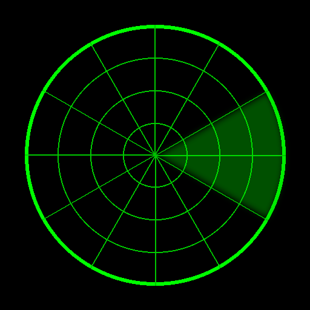

# GreenScope

Green-on-black Windows console system monitor written in C. Minimal, fast, retro.



## Features
- CPU usage (overall)
- Memory usage (total/free)
- NVIDIA GPU: utilization, VRAM, temperature, power, clocks, and what's limiting it (via the driver's NVML, no install)
- Disk usage (all fixed drives)
- Network throughput (sum of active adapters)
- Clock (top-right), uptime, and battery indicator
- ASCII/Unicode border toggle (`A`)
- Press `Q` to quit

## Build (MSYS2 MinGW UCRT64)

1. Install MSYS2 and open **MSYS2 MinGW UCRT64**.
2. Install toolchain (first time only):
   ```bash
   pacman -S --needed mingw-w64-ucrt-x86_64-gcc mingw-w64-ucrt-x86_64-binutils
   ```
3. Clone and build:
   ```bash
   git clone https://github.com/Jffrsntaylor/greenscope.git
   cd greenscope
   ./build.bat
   ```
   - If `windres` is available, the EXE will embed the icon.
   - If not, it still builds; you can set an icon on a desktop shortcut.

**Manual compile** (no icon):
```bash
gcc -O2 -s -o GreenScope.exe src/greenscope.c -lIphlpapi
```

**Manual compile with icon**:
```bash
windres greenscope.rc greenscope_res.o
gcc -O2 -s -o GreenScope.exe src/greenscope.c greenscope_res.o -lIphlpapi
```

## Run
- Double‑click `GreenScope.exe` or run it from a terminal.  
- (Optional) Create a Desktop **shortcut** → **Properties** → **Change Icon…** and select `icons/greenscope.ico`.

## Notes
- Tested on Windows 10/11 terminals.
- No admin privileges required. No network calls, no file writes.

## License
MIT
